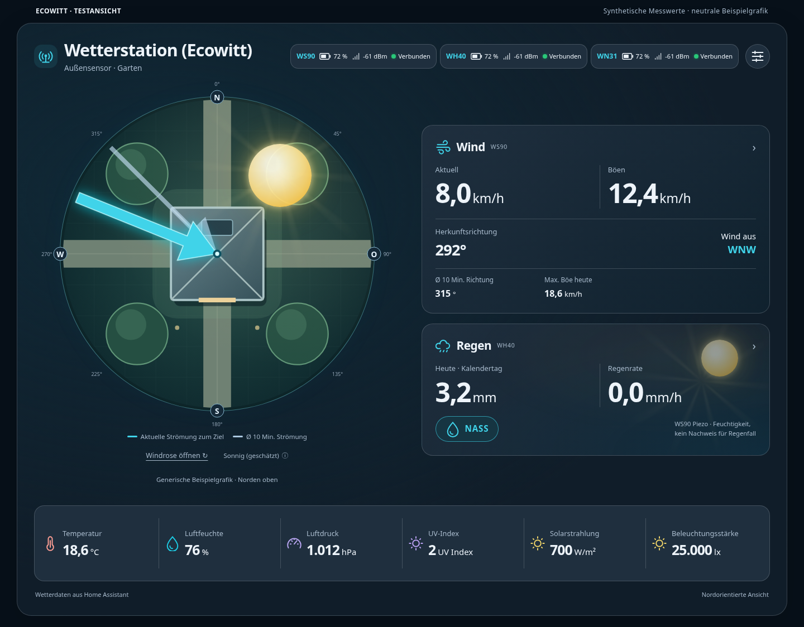

# Ecowitt Weather Card

Die Ecowitt Weather Card zeigt lokale Wetterdaten aus Home Assistant. Windrichtung und Wettereffekte erscheinen in einer nordorientierten Grafik. Die Karte zeigt außerdem Niederschlag, Außenklima und weitere Messwerte mit Verläufen und Wetterrekorden. Ihr Layout passt sich der verfügbaren Breite an.

## Einrichtung

1. In HACS unter **Benutzerdefinierte Repositories** die URL `https://github.com/tach2004/ecowitt-weather-card` in der Kategorie **Dashboard** hinzufügen und **Ecowitt Weather Card** installieren.
2. Das Dashboard neu laden und im Bearbeitungsmodus unter **Karte hinzufügen** die **Ecowitt Weather Card** auswählen.
3. Im visuellen Karteneditor die vorhandenen Wetterentitäten zuordnen und speichern. Dort lässt sich auch ein eigenes Hintergrundbild aus Home Assistant auswählen. [Private Bildquellen](docs/PRIVATE_IMAGES.md)

Für einen eigenen Wetterreiter eignet sich die [Panel-Vorlage](examples/view-panel.yaml). Für eine Ansicht mit weiteren Karten gibt es die [Sections-Vorlage](examples/view-sections.yaml).

Details zur manuellen Installation und zu den Einstellungen stehen in der [Installationsanleitung](docs/INSTALLATION.md) und der [Konfigurationsübersicht](docs/CONFIGURATION.md).
